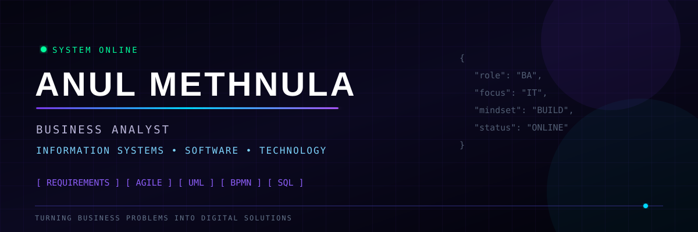
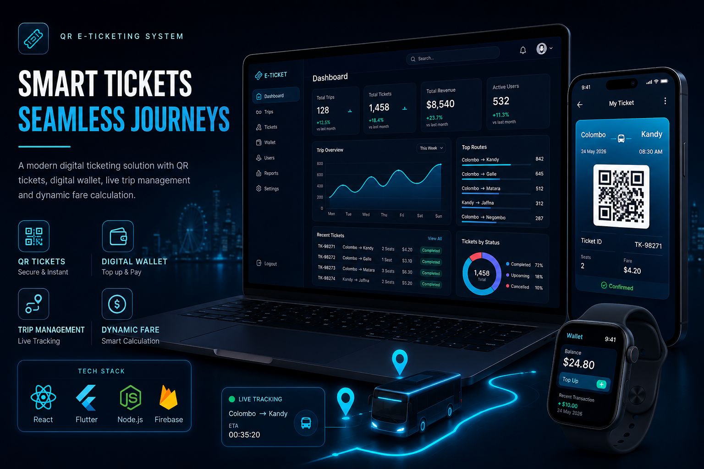
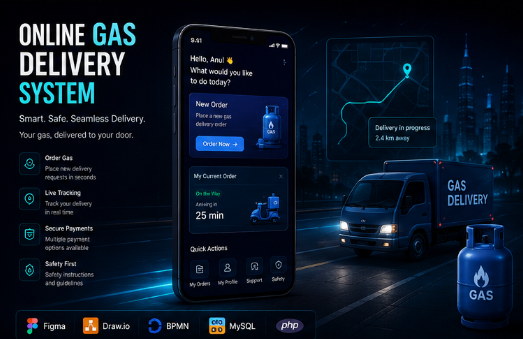

<p align="center">
  
</p>

<div align="center">

# Hi, I'm Anul 👋

**Project Management • Business Analysis • Digital Transformation**

<a href="https://anulmethnula.vercel.app/">Portfolio</a> · <a href="https://www.linkedin.com/in/anul-methnula/">LinkedIn</a> · <a href="mailto:anulmethnula@gmail.com">Email</a>

</div>

---

## About Me

I am an **Information Technology for Business undergraduate** focused on turning business problems into clear requirements, practical plans and useful digital solutions.

My main interests are **Project Management, Business Analysis, Agile delivery and process improvement**.

## Current Focus

- Project coordination
- Requirements gathering
- Stakeholder communication
- Business process analysis
- Agile and Scrum
- Documentation and planning

## Selected Projects

<table>
<tr>
<td width="33%" align="center">
<br/>
<b>QR E-Ticketing System</b><br/>
Project coordination, requirements and Agile delivery
</td>
<td width="33%" align="center">
<br/>
<b>Online Gas Delivery</b><br/>
Business analysis, BPMN and wireframes
</td>
<td width="33%" align="center">
<br/>
<b>ERP Research</b><br/>
Enterprise systems and digital transformation
</td>
</tr>
</table>

## Tools & Skills

`Jira` · `Figma` · `Draw.io` · `MS Project` · `Excel` · `React` · `Node.js` · `Java` · `MySQL` · `Git`

## What I Enjoy

```text
Understand the problem → Define the need → Plan clearly → Support delivery → Improve the result
```

---

<div align="center">
  <b>Building better systems through clear thinking and good coordination.</b>
</div>
