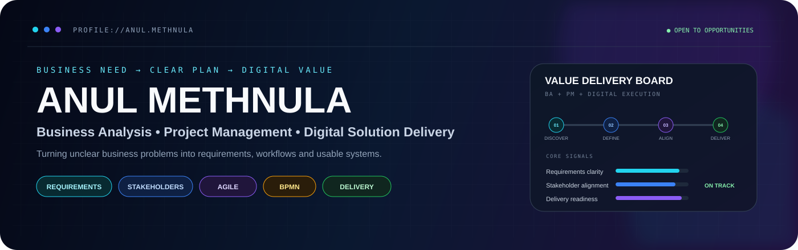

  

  
  
  

## Professional Profile

I am an **Information Technology for Business undergraduate** focused on **Business Analysis, Project Management and digital solution delivery**.

I enjoy turning unclear business needs into **clear requirements, practical workflows, coordinated delivery and systems people can actually use**.

## Featured Business Systems

| Project | Business value | Stack |
|---|---|---|
| [**CAMY Entrepreneurs Digital Platform**](https://github.com/anulmethnula/CAMY-Entrepreneurs-DIGITAL-PLATFORM) | Connects entrepreneur selling, COD fulfilment, payouts, stock and credit operations in one workflow | React · PHP · MySQL |
| [**ZEVENRA Commerce Platform**](https://github.com/anulmethnula/zevenra-website) | Supports fashion sales, checkout, pre-orders, stock and admin operations | React · TypeScript · Vercel |
| [**Supun ERP**](https://github.com/anulmethnula/Supun-ERP) | Connects purchasing, inventory, sales and receivables processes | Laravel · PHP · MariaDB |
| [**Supun Feedback System**](https://github.com/anulmethnula/feedback-system) | Turns QR guest feedback into structured operational data for administrators | React · Firebase · Capacitor |

  
  

## What I Bring

| Business Analysis | Project Management | Digital Delivery |
|---|---|---|
| Requirements gathering | Planning & coordination | Solution thinking |
| Stakeholder analysis | Milestone tracking | Technical collaboration |
| Process modelling | Team communication | UI / workflow understanding |
| BPMN & UML | Agile & Scrum | Process improvement |

## How I Work

`Understand the problem` → `Define what matters` → `Align people` → `Plan the workflow` → `Support delivery` → `Improve the result`

## Tools & Platforms

`Jira` · `MS Project` · `Figma` · `Draw.io` · `Excel` · `React` · `TypeScript` · `PHP` · `Laravel` · `MySQL` · `Firebase` · `Git` · `GitHub`

## Additional Work

- [**CAMY Community Event Registration**](https://github.com/anulmethnula/camy-event-comformation-) — lightweight registration workflow with Vercel Functions and Google Sheets
- [**Portfolio Website**](https://github.com/anulmethnula/my-protofilo) — visual portfolio for Business Analysis, Project Management and digital work

---

<b>Open to opportunities where business understanding, coordination and digital delivery need to work together.</b>

