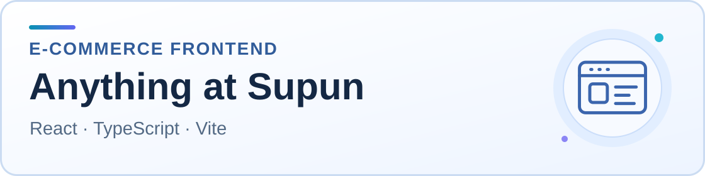
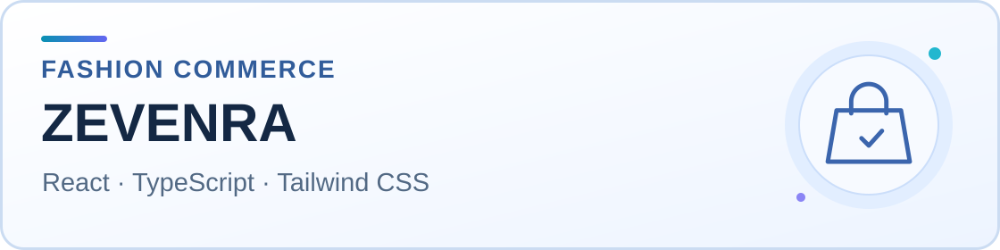
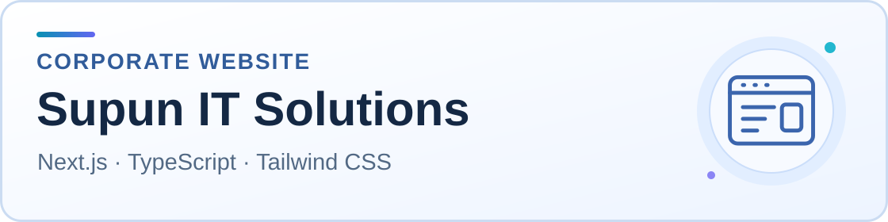
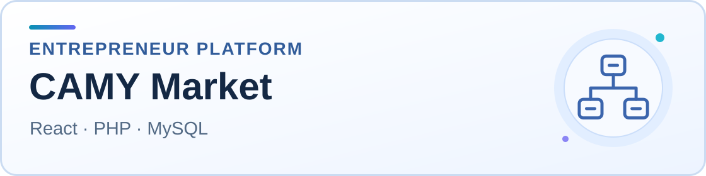
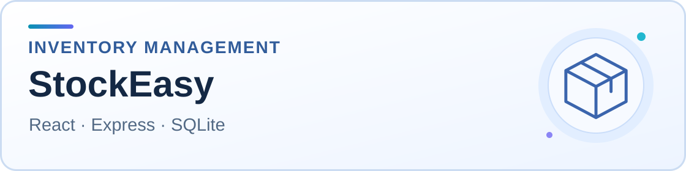
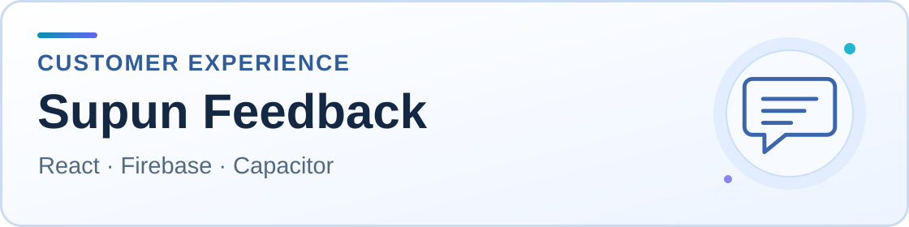
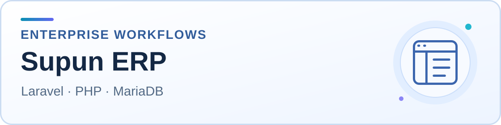
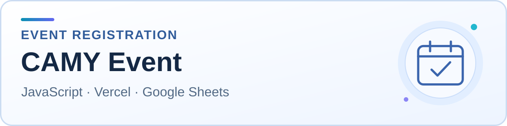

  

  
  
  

## About Me

<b>Frontend Developer &nbsp;·&nbsp; Business Analyst &nbsp;·&nbsp; Project Manager</b>

I am an IT for Business undergraduate who combines frontend development, business analysis and project coordination. I build responsive digital experiences and translate business needs into practical interfaces and workflows.

## Core Expertise

<table>
<tr>
<td width="33%" align="center" valign="top">
<b>Frontend Development</b>  
Responsive UI 
React &amp; TypeScript 
Reusable components 
API integration &amp; testing
</td>
<td width="33%" align="center" valign="top">
<b>Business Analysis</b>  
Requirements &amp; stakeholders 
Process modelling 
BPMN &amp; UML 
Business workflows
</td>
<td width="33%" align="center" valign="top">
<b>Project Management</b>  
Planning &amp; coordination 
Agile &amp; Scrum 
Milestone tracking 
Team communication
</td>
</tr>
</table>

## Selected Projects

A selection of development and business systems work, covering responsive interfaces, e-commerce and operational workflows.

<table>
<tr>
<td width="50%" align="center" valign="top">

 
Responsive storefront, product browsing and checkout UI.
 
Prototype · WooCommerce integration pending
 
<a href="https://github.com/anulmethnula/anythingatsupun"><b>Repository</b></a>
</td>
<td width="50%" align="center" valign="top">

 
Fashion storefront, pre-orders and customer checkout.
 
Live commerce website
 
<a href="https://www.zevenra.com/"><b>Live website</b></a>
</td>
</tr>
<tr>
<td width="50%" align="center" valign="top">

 
Responsive company portfolio and interactive project showcase.
 
Company portfolio
 
<a href="https://github.com/anulmethnula/Supun-IT-Solutions-Portfolio"><b>Repository</b></a> &nbsp;·&nbsp; <a href="https://it.supuncompanies.com/"><b>Website</b></a>
</td>
<td width="50%" align="center" valign="top">

 
Order, stock, payout and entrepreneur workflows.
 
Business operations
 
<a href="https://github.com/anulmethnula/CAMY-Entrepreneurs-DIGITAL-PLATFORM"><b>Repository</b></a> &nbsp;·&nbsp; <a href="https://camymarket.com/"><b>Live platform</b></a>
</td>
</tr>
<tr>
<td width="50%" align="center" valign="top">

 
Purchase orders, goods received, stock and deliveries.
 
Local-first application
 
<a href="https://github.com/anulmethnula/stock-management-system"><b>Repository</b></a>
</td>
<td width="50%" align="center" valign="top">

 
QR feedback forms and administrator review workflows.
 
Collaborative project
 
<a href="https://github.com/anulmethnula/feedback-system"><b>Collaborative repository</b></a>
</td>
</tr>
<tr>
<td width="50%" align="center" valign="top">

 
Purchasing, inventory, sales and receivables workflows.
 
Collaborative project
 
<a href="https://github.com/anulmethnula/Supun-ERP"><b>Collaborative repository</b></a>
</td>
<td width="50%" align="center" valign="top">

 
Event registration, validation and confirmation experience.
 
Event registration project
 
<a href="https://github.com/anulmethnula/camy-event-registration"><b>Repository</b></a> &nbsp;·&nbsp; <a href="https://camy-event-comformation.vercel.app"><b>Live demo</b></a>
</td>
</tr>
</table>

Project context: Supun ERP and Supun Feedback are collaborative/forked repositories. Anything at Supun is a frontend prototype, with backend integration pending. Project descriptions summarize system capabilities, not sole authorship.

## How I Work

<b>Discover → Analyse → Design → Develop → Test → Deliver</b>

## Tech Stack & Tools

### Frontend Development

  
  
  
  
  
  
  
  
  

### Backend & Data Familiarity

  
  
  
  

### Planning & Design

  
  
  
  
  

### Version Control & Deployment

  
  
  

## More Work

[**Personal portfolio**](https://anulmethnula.vercel.app/) · [Portfolio source](https://github.com/anulmethnula/anul-methnula-portfolio) · [All public repositories](https://github.com/anulmethnula?tab=repositories)

---

<b>Open to Frontend Development, Business Analysis and Project Management opportunities.</b>

<a href="https://www.linkedin.com/in/anul-methnula/">LinkedIn</a> &nbsp;·&nbsp; <a href="mailto:anulmethnula@gmail.com">Email</a> &nbsp;·&nbsp; <a href="https://anulmethnula.vercel.app/">Portfolio</a>

