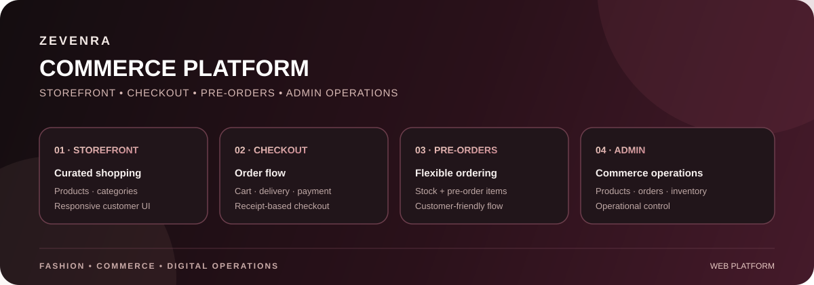

  

  
  
  

## Professional Profile

I am an **Information Technology for Business undergraduate** focused on **Business Analysis, Project Management and digital solution delivery**.

I turn unclear business needs into **clear requirements, practical workflows, coordinated delivery and usable systems**.

## Featured Business Systems

Selected projects across business operations, commerce and customer experience.

<table>
<tr>
<td width="50%" valign="top">

 
<b>CAMY Entrepreneurs Digital Platform</b>
 
Entrepreneur orders, COD fulfilment, stock control, payouts and credit operations.
  
<a href="https://github.com/anulmethnula/CAMY-Entrepreneurs-DIGITAL-PLATFORM">Repository</a> &nbsp;·&nbsp; <a href="https://camymarket.com/">Live platform</a>
</td>
<td width="50%" valign="top">

 
<b>ZEVENRA Commerce Platform</b>
 
Fashion shopping experience with storefront, checkout, pre-orders and admin workflows.
  
<a href="https://www.zevenra.com/">Live website</a>
</td>
</tr>
<tr>
<td width="50%" valign="top">

 
<b>Supun ERP</b>
 
Purchasing, inventory, sales, customer receipts and receivables in one workflow.
  
<a href="https://github.com/anulmethnula/Supun-ERP">Collaborative repository</a>
</td>
<td width="50%" valign="top">

 
<b>Supun Feedback System</b>
 
QR-based guest feedback, protected admin review and mobile-friendly access.
  
<a href="https://github.com/anulmethnula/feedback-system">Collaborative repository</a>
</td>
</tr>
<tr>
<td width="50%" valign="top">

 
<b>StockEasy — Stock Management</b>
 
Local-first purchasing, GRN, branch stock, deliveries and correction history.
  
<a href="https://github.com/anulmethnula/stock-management-system">Repository</a>
</td>
<td width="50%" valign="top">

 
<b>Anything at Supun — E-commerce Redesign</b>
 
Modern responsive storefront prototype; WooCommerce integration is pending.
  
<a href="https://github.com/anulmethnula/anythingatsupun">Frontend prototype</a>
</td>
</tr>
</table>

## What I Bring

<table>
<tr>
<td width="33%" valign="top">
<b>01 / Business Analysis</b>
  
Requirements gathering 
Stakeholder analysis 
Process modelling 
BPMN &amp; UML
</td>
<td width="33%" valign="top">
<b>02 / Project Management</b>
  
Planning &amp; coordination 
Milestone tracking 
Team communication 
Agile &amp; Scrum
</td>
<td width="33%" valign="top">
<b>03 / Digital Delivery</b>
  
Solution thinking 
Technical collaboration 
UI &amp; workflow understanding 
Process improvement
</td>
</tr>
</table>

## How I Work

**Understand the problem** → **Clarify requirements** → **Align people** → **Plan the workflow** → **Support delivery** → **Improve the result**

## Tools & Platforms

**Planning & analysis:** Jira · MS Project · Figma · Draw.io · Excel

**Development & data:** React · TypeScript · PHP · Laravel · MySQL · Firebase

**Collaboration & version control:** Git · GitHub

## More Work

- **[CAMY Community Event Registration](https://github.com/anulmethnula/camy-event-registration)** — serverless event registration with Google Sheets.
- **[Supun IT Solutions Portfolio](https://github.com/anulmethnula/Supun-IT-Solutions-Portfolio)** — showcase of company projects, technologies and team work.
- **[Personal Portfolio Website](https://github.com/anulmethnula/anul-methnula-portfolio)** — my BA, PM and digital delivery portfolio.

> **Project transparency:** Supun ERP and Supun Feedback System are collaborative/forked repositories. Anything at Supun is a frontend prototype; its live backend integration is not complete.

---

<b>Open to opportunities where business understanding, coordination and digital delivery work together.</b>

