  

  
  
  

## Professional Profile

I am an **Information Technology for Business undergraduate** focused on **Business Analysis, Project Management and digital solution delivery**.

I turn unclear business needs into **clear requirements, practical workflows, coordinated delivery and usable systems**.

## Featured Business Systems

<table>
<tr>
<td width="50%" align="center" valign="top">
 
<b>CAMY Entrepreneurs Digital Platform</b> 
COD • stock • payouts • entrepreneur credit
</td>
<td width="50%" align="center" valign="top">
 
<b>ZEVENRA Commerce Platform</b> 
Storefront • checkout • pre-orders • admin operations
</td>
</tr>
<tr>
<td width="50%" align="center" valign="top">
 
<b>Supun ERP</b> 
Purchasing • inventory • sales • receivables
</td>
<td width="50%" align="center" valign="top">
 
<b>Supun Feedback System</b> 
QR feedback • secure admin • web + mobile
</td>
</tr>
</table>

  
  

## What I Bring

| Business Analysis | Project Management | Digital Delivery |
|---|---|---|
| Requirements gathering | Planning & coordination | Solution thinking |
| Stakeholder analysis | Milestone tracking | Technical collaboration |
| Process modelling | Team communication | UI / workflow understanding |
| BPMN & UML | Agile & Scrum | Process improvement |

## How I Work

`Understand the problem` → `Define what matters` → `Align people` → `Plan the workflow` → `Support delivery` → `Improve the result`

## Tools & Platforms

`Jira` · `MS Project` · `Figma` · `Draw.io` · `Excel` · `React` · `TypeScript` · `PHP` · `Laravel` · `MySQL` · `Firebase` · `Git` · `GitHub`

## More Work

- [**CAMY Community Event Registration**](https://github.com/anulmethnula/camy-event-registration) — serverless registration workflow with Google Sheets
- [**Portfolio Website**](https://github.com/anulmethnula/anul-methnula-portfolio) — visual portfolio for BA, PM and digital delivery work

---

<b>Open to opportunities where business understanding, coordination and digital delivery work together.</b>

